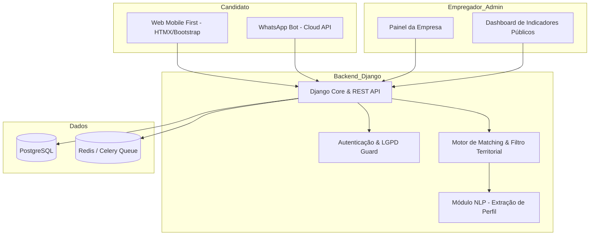

# Vaga Fácil GO — Central Simplificada de Oportunidades de Emprego

> **Menos burocracia. Mais inclusão produtiva.**  
> *Plataforma inteligente de centralização de vagas e candidatura sem atrito para o Estado de Goiás.*

---

## 1. Visão Executiva e Diagnóstico do Problema

### O Problema Real
No mercado de trabalho goiano (especialmente no eixo metropolitano Goiânia – Aparecida de Goiânia – Senador Canedo), existe um descompasso estrutural:
1. **Dispersão e Descentralização:** Vagas de comércio local, serviços e indústria estão pulverizadas em grupos de WhatsApp informais, feeds do Instagram, murais físicos e plataformas de grande porte (LinkedIn, Gupy, Catho).
2. **Barreira Digital e Cognitiva:** As plataformas tradicionais exigem formulários de dezenas de etapas, testes extensos e cadastros redundantes. Isso gera **abandono de candidatura** massivo entre trabalhadores operacionais, jovens do primeiro emprego e pessoas com baixa fluência digital.
3. **Dificuldade das PMEs e Comércios Locais:** Pequenas empresas não têm orçamento para contratar plataformas caras de ATS (Applicant Tracking System) nem tempo para filtrar centenas de mensagens desorganizadas no WhatsApp direto do proprietário.

### A Tese da Solução
O **Vaga Fácil GO** atua como uma infraestrutura pública-privada simplificada:
- **Para o Cidadão:** Criação de perfil em 2 minutos (via Web ultraleve ou conversacional via WhatsApp) e candidatura em **1 clique**.
- **Para o Empregador Local:** Painel limpo para publicar vagas em menos de 3 minutos, definir critérios eliminatórios automáticos e receber uma lista organizada de candidatos aptos.
- **Para o Estado de Goiás:** Ferramenta de inclusão produtiva, geração de métricas de empregabilidade regional e integração com políticas públicas (SINE Goiás / Secretaria da Retomada).

---

## 2. Diferenciais Competitivos e Inovação

```
┌─────────────────────────────────────────────────────────────┐
│                       VAGA FÁCIL GO                         │
├──────────────────────────────┬──────────────────────────────┤
│ Plataformas Tradicionais     │ Modelo Vaga Fácil GO         │
├──────────────────────────────┼──────────────────────────────┤
│ Formulários de 30 minutos    │ Perfil único em 2 minutos    │
│ Foco em cargos corporativos  │ Foco em comércio, serviços   │
│ Exige app pesado ou desktop  │ Web ultraleve e WhatsApp     │
│ Currículo em PDF obrigatório │ Perfil estruturado por dados │
│ Triagem burocrática          │ Matching por proximidade     │
└──────────────────────────────┴──────────────────────────────┘
```

### Inovações-Chave:
1. **Cadastro Conversacional (Omnichannel):** O trabalhador pode responder perguntas simples por mensagem (ou áudio) via WhatsApp. O sistema extrai e preenche o perfil automaticamente.
2. **Triagem Antiatolamento para o Empregador:** Candidatura em 1 clique **não significa currículos desqualificados**. A empresa define até 3 critérios objetivos de corte (ex: "Disponibilidade para trabalhar aos sábados?", "Reside a até 10km do local?"). O sistema só destaca quem cumpre os requisitos.
3. **Matching Territorial Georreferenciado:** Priorização de oportunidades próximas da residência do trabalhador, reduzindo custos de transporte e evasão de postos de trabalho.
4. **Respeito Integral à LGPD:** O candidato controla quais dados são visíveis e para quais vagas compartilha seu histórico, com rastreabilidade de consentimento.

---

## 3. Modelo Operacional (Híbrido e Multicanal)

O projeto opera sob o tripé:
- **Origem das Vagas (Híbrida):**
  - *Publicação Direta:* Empresas locais, comércios e prestadores de serviço cadastram diretamente.
  - *Curadoria Ativa:* Parcerias com prefeituras, órgãos governamentais (SINE), entidades setoriais (CDL, Fecomércio, FIEG) e vagas públicas autorizadas com direcionamento oficial.
- **Experiência do Candidato (Multicanal):**
  - *Web App Mobile-First:* Interface extremamente rápida, carregando em conexões móveis lentas (3G/4G).
  - *Bot WhatsApp:* Consulta de vagas compatíveis no bairro/cidade e confirmação de candidatura via chat.

---

## 4. Arquitetura Tecnológica Proposta



### Especificações Técnicas:
- **Backend:** Python 3.12 + **Django 5.x** (segurança nativa, ORM robusto e velocidade de desenvolvimento).
- **APIs & Mensageria:** Django REST Framework + Celery/Redis para envios assíncronos de alertas e notificações.
- **Frontend:** Django Templates + Bootstrap 5 / TailwindCSS + HTMX (interatividade fluida sem peso de frameworks SPA pesados).
- **Banco de Dados:** PostgreSQL com extensões de busca textual e suporte a dados geográficos leves.
- **Canal WhatsApp:** WhatsApp Cloud API oficial (Meta) com webhooks integrados ao Django.
- **Inteligência Artificial:** Processamento de Linguagem Natural (LLM leve) para categorização semântica de cargos e normalização de termos de experiência.

---

## 5. Plano Piloto (6 Meses) e Metas de Impacto

### Território Piloto:
- **Goiânia** (Polo de serviços e comércio)
- **Aparecida de Goiânia** (Polo logístico e industrial)
- **Senador Canedo** (Polo petroquímico e serviços em expansão)

### Metas do Piloto:
| Indicador de Impacto | Meta Mínima (6 meses) | Meta Alvo |
| :--- | :--- | :--- |
| **Trabalhadores com Perfil Ativo** | 500 | 1.200 |
| **Pequenas e Médias Empresas** | 30 | 60 |
| **Vagas Oferecidas** | 150 | 350 |
| **Candidaturas Efetivadas** | 1.000 | 2.500 |
| **Taxa de Conversão em Entrevistas** | 15% | 25% |
| **Tempo Médio de Cadastro** | < 3 minutos | < 2 minutos |

---

## 6. Alinhamento com Políticas Públicas e Editais em Goiás

### Potenciais Linhas de Fomento:
- **FAPEG (Fundação de Amparo à Pesquisa do Estado de Goiás):** Editais de Inovação Social, Centelha Goiás, Tecnova ou Bolsas de Desenvolvimento Tecnológico e Extensão Inovadora (DTI/BDI).
- **SEDI (Secretaria de Ciência, Tecnologia e Inovação):** Programas de aceleração e modernização digital de serviços públicos.
- **Secretaria da Retomada:** Programas de geração de renda, inclusão de jovens vulneráveis e microcrédito.

### Argumentos de Enquadramento em Editais:
1. **Inclusão Produtiva:** Reduz a exclusão digital de quem não domina computadores tradicionais.
2. **Estímulo à Economia Local:** Dá visibilidade ao micro e pequeno empresário de bairro.
3. **Geração de Dados Estratégicos (Open Data Governamental):** Mapeia quais funções e bairros têm excesso de demanda ou carência de profissionais no Estado.

